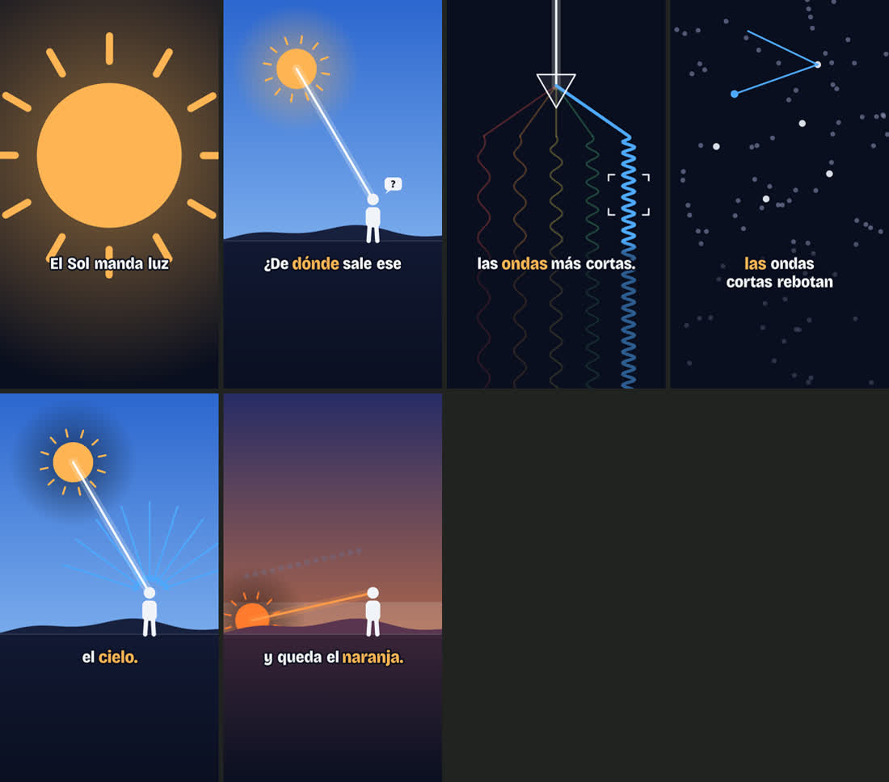
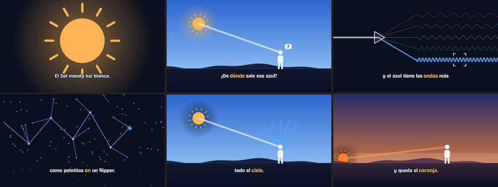

# Explainer: Motor y Pipeline de Videos Explicativos Animados





**Explainer** genera videos explicativos animados en HTML5 Canvas autocontenidos. Combina un modelo de documento declarativo (`explainer.json`) validado con **Zod**, compilación determinista a una página HTML autoejecutable, locución neural automática por escenas con **edge-tts**, subtítulos sincronizados palabra por palabra (`karaoke` o `simples`) y renderizado cuadro por cuadro a **MP4 en 1080p** mediante **Playwright** y **ffmpeg**.

Funciona de forma adaptativa en cuatro relaciones de aspecto: vertical `9:16` (TikTok, Reels, Shorts), horizontal `16:9` (YouTube, clases, presentaciones), cuadrado `1:1` (LinkedIn, X) y feed `4:5` (Instagram).

---

## Tabla de contenidos

1. [Arquitectura del pipeline](#1-arquitectura-del-pipeline)
2. [Requisitos previos](#2-requisitos-previos)
3. [Instalación paso a paso](#3-instalación-paso-a-paso)
4. [Instalación como Skill para agentes (Antigravity / Claude Code)](#4-instalación-como-skill-para-agentes-antigravity--claude-code)
5. [Estructura del proyecto](#5-estructura-del-proyecto)
6. [Guía paso a paso: crear un Explainer desde cero (`explainer.json`)](#6-guía-paso-a-paso-crear-un-explainer-desde-cero-explainerjson)
7. [Referencia completa de configuración (`explainer.json`)](#7-referencia-completa-de-configuración-explainerjson)
8. [Configuración y menú de voces neurales (`scripts/voces.py`)](#8-configuración-y-menú-de-voces-neurales-scriptsvocespy)
9. [Sincronización con voz grabada por el usuario (Whisper)](#9-sincronización-con-voz-grabada-por-el-usuario-whisper)
10. [Laboratorio de inspección visual y exportación MP4 (`scripts/render.mjs`)](#10-laboratorio-de-inspección-visual-y-exportación-mp4-scriptsrendermjs)
11. [Controles del reproductor web y parámetros URL](#11-controles-del-reproductor-web-y-parámetros-url)
12. [Reglas técnicas e invariantes del motor](#12-reglas-técnicas-e-invariantes-del-motor)
13. [Créditos y licencia](#13-créditos-y-licencia)

---

## 1. Arquitectura del pipeline

El flujo declarativo transforma una especificación JSON en HTML interactivo, locución neural y video MP4 verificable cuadro por cuadro:

```text
explainer.json
   │
   ├─► 1. scripts/schema.mjs      (Valida meta, voz y escenas con Zod)
   │
   ├─► 2. edge-tts + ffprobe      (Sintetiza voz escena por escena + pausas -> voz.mp3 + audio_meta.json)
   │
   ├─► 3. scripts/compilador.mjs  (Compila HTML5 Canvas + escala palabras s.words a audio_dur -> index.html)
   │
   ├─► 4. scripts/simular.cjs     (Simula todos los cuadros en 9:16, 16:9, 1:1 y 4:5 sin navegador)
   │
   ├─► 5. scripts/render.mjs      (Inspección visual con hoja de contacto out/hoja.png y captura PNG -> out/index.mp4)
   │
   └─► 6. ffmpeg                  (Mux de video H.264 + audio AAC -> explainer-con-voz.mp4)
```

Cada cuadro dibujado en el `<canvas>` depende únicamente del tiempo global `T` (en segundos) y de generadores pseudoaleatorios con semilla (`rng`). El resultado es idéntico en el navegador interactivo, en las fotos de inspección y en cada cuadro del archivo MP4.

---

## 2. Requisitos previos

Antes de instalar, verificá contar con estas herramientas disponibles en el `PATH` del sistema:

| Herramienta | Versión / Uso | Verificación |
|---|---|---|
| **Node.js** | `>= 18` (ejecución de compilador, simulador y Playwright) | `node --version` |
| **Python** | `>= 3.9` (orquestador `pipeline.py` y menú `voces.py`) | `python --version` |
| **ffmpeg** | Mezcla de audio, pausas de silencio, hojas de contacto y MP4 | `ffmpeg -version` |
| **ffprobe** | Incluido con ffmpeg; mide duración real por escena en segundos | `ffprobe -version` |

### Instalar `ffmpeg` y `ffprobe`

- **Windows:** `winget install Gyan.FFmpeg` (o `winget install ffmpeg`) y reiniciar la terminal.
- **macOS:** `brew install ffmpeg`
- **Ubuntu / Debian:** `sudo apt update && sudo apt install ffmpeg`

---

## 3. Instalación paso a paso

### Paso 1: Clonar el repositorio

```bash
git clone https://github.com/superpollo02/explainer.git
cd explainer
```

### Paso 2: Instalar dependencias Node (`playwright` y `zod`) y navegador Chromium

Las dependencias Node viven en [scripts/package.json](scripts/package.json).

**En macOS / Linux / Git Bash:**

```bash
cd scripts
npm install
npx playwright install chromium
cd ..
```

**En Windows (PowerShell):**

Si PowerShell bloquea `npm.ps1` o `npx.ps1` por `ExecutionPolicy`, ejecutá los comandos invocando `cmd.exe`:

```powershell
cmd.exe /c "cd scripts && npm install && npx playwright install chromium"
```

### Paso 3: Instalar el motor de voz neural (`edge-tts`)

`edge-tts` utiliza las voces neurales de Microsoft Edge sin requerir claves de API ni suscripciones:

```bash
pip install edge-tts
```

Comprobá la instalación listando voces disponibles en español:

```bash
python scripts/voces.py --listar es-AR
```

---

## 4. Instalación como Skill para agentes (Antigravity / Claude Code)

Este repositorio funciona también como un skill listo para usarse desde asistentes con agente:

### En Antigravity (global)

Copiá o cloná el repositorio en `~/.gemini/config/skills/explainer`:

**macOS / Linux:**

```bash
git clone https://github.com/superpollo02/explainer.git ~/.gemini/config/skills/explainer
```

**Windows (PowerShell):**

```powershell
git clone https://github.com/superpollo02/explainer.git "$env:USERPROFILE\.gemini\config\skills\explainer"
```

### En Claude Code

**macOS / Linux:**

```bash
git clone https://github.com/superpollo02/explainer.git ~/.claude/skills/explainer
```

**Windows (PowerShell):**

```powershell
git clone https://github.com/superpollo02/explainer.git "$env:USERPROFILE\.claude\skills\explainer"
```

Recordá instalar las dependencias dentro de la carpeta `scripts/` de la ruta donde hayas clonado el skill.

---

## 5. Estructura del proyecto

```text
explainer/
├── README.md                      Documentación completa de instalación, configuración y uso
├── SKILL.md                       Directivas operativas para agentes de IA
├── assets/
│   ├── plantilla.html             Motor base completo en un solo HTML (ejemplo de 4 escenas)
│   └── ejemplos/
│       └── planeta-vertical.html  Ejemplo de referencia (70 s)
├── docs/
│   ├── demo-horizontal.jpg        Vista previa formato 16:9
│   └── demo-vertical.jpg          Vista previa formato 9:16
├── explainer-campus/              Proyecto de ejemplo completo (Campus Esalud 2026/27)
│   ├── explainer.json             Especificación declarativa de 7 escenas
│   ├── audio_meta.json            Tiempos reales medidos con ffprobe por escena
│   ├── voz.mp3                    Locución neural consolidada (es-MX-JorgeNeural)
│   ├── index.html                 Reproductor HTML compilado con subtítulos karaoke
│   └── explainer-campus-con-voz.mp4
├── references/
│   ├── formatos.md                Zonas seguras, foco de cámara y composición por aspecto
│   ├── estilos.md                 Paletas (:root), fuentes, trazos y tono de guion
│   ├── escenas.md                 Catálogo de patrones visuales, errores y 15 íconos
│   ├── movimiento.md              Curvas, resortes, tiempos y protocolo del laboratorio
│   └── audio.md                   Sincronía con voz grabada externa (Whisper)
└── scripts/
    ├── package.json               Dependencias: zod ^4.6.7 y playwright ^1.64.1
    ├── schema.mjs                 Esquema Zod (ExplainerSpecSchema) para explainer.json
    ├── compilador.mjs             Compilador puro explainer.json + audio_meta.json -> index.html
    ├── pipeline.py                Orquestador: valida -> sintetiza voz -> compila -> simula
    ├── voces.py                   CLI y menú interactivo de voces neurales (edge-tts)
    ├── simular.cjs                Auditoría sin navegador en 9:16, 16:9, 1:1 y 4:5
    ├── render.mjs                 Capturas, hojas de contacto (--hoja) y exportación MP4
    └── palabras.mjs               Conversión de JSON de Whisper a SCRIPT y WORDS
```

---

## 6. Guía paso a paso: crear un Explainer desde cero (`explainer.json`)

El proyecto [explainer-campus/explainer.json](explainer-campus/explainer.json) muestra un ejemplo completo en producción. Para crear uno nuevo:

### Paso 1: Crear la carpeta y la especificación `explainer.json`

Creá un subdirectorio de proyecto, por ejemplo `mi-video/explainer.json`:

```json
{
  "version": "1.0",
  "meta": {
    "titulo": "Título de tu Explainer",
    "descripcion": "Resumen corto para el panel lateral.",
    "formato": "9:16",
    "estilo": "Noche",
    "subtitulos": "karaoke",
    "ritmo": 1.35,
    "cola": 0.8
  },
  "voz": {
    "engine": "edge-tts",
    "locutor": "es-MX-JorgeNeural",
    "rate": "+5%",
    "pitch": "+0Hz",
    "pausa": 0.5,
    "say": {
      "2026": "dos mil veintiséis",
      "IA": "inteligencia artificial"
    }
  },
  "escenas": [
    {
      "id": "intro",
      "texto": "En 2026 cambiará la forma en que organizás tus cursos.",
      "hablado": "En dos mil veintiséis cambiará la forma en que organizás tus cursos.",
      "alt": "Tarjeta animada de bienvenida sobre grilla técnica.",
      "cam": [[0, 0, -2, 1.25], [0.8, 0, 0, 1]],
      "drawCode": "drawBackgroundGrid(F, 0.2);\nconst A = F.area;\nconst k = pop(t, 0.1, 0.5);\nctx.save();\nctx.globalAlpha = k;\nmedicalBadge(A.cx, A.cy, 10, 1);\ntxt('COHORTE 2026', A.cx, A.cy + 16, { size: 4.5, color: C.accent, w: 800 });\nctx.restore();"
    }
  ]
}
```

### Paso 2: Ejecutar el pipeline integral

Corré `scripts/pipeline.py` desde la raíz del repositorio:

```bash
python scripts/pipeline.py mi-video/explainer.json
```

Qué ejecuta automáticamente:
1. **Validación de esquema (`[1/4]`):** Valida todos los tipos y campos obligatorios con [scripts/schema.mjs](scripts/schema.mjs).
2. **Locución neural (`[2/4]`):** Genera `audio_parts/scene_i.mp3` por escena con `edge-tts`, mide la duración hablada real (`audio_dur`) mediante `ffprobe`, agrega pausas de silencio de `voz.pausa` segundos, consolida `mi-video/voz.mp3` y escribe `mi-video/audio_meta.json`.
3. **Compilación HTML (`[3/4]`):** Ejecuta [scripts/compilador.mjs](scripts/compilador.mjs) inyectando `AUDIO_META`, escalando los tiempos de cada palabra (`s.words`) respecto a `audio_dur` y generando `mi-video/index.html`.
4. **Simulación en los 4 formatos (`[4/4]`):** Corre [scripts/simular.cjs](scripts/simular.cjs) con `--todos` (`9:16`, `16:9`, `1:1`, `4:5`) verificando que no existan valores no finitos (`NaN`/`Infinity`) ni errores de ejecución.

#### Banderas disponibles en `scripts/pipeline.py`

| Bandera | Descripción | Ejemplo |
|---|---|---|
| `--out <ruta>` | Ruta alternativa para el HTML de salida | `--out mi-video/preview.html` |
| `--skip-voice` | Omite síntesis TTS; reutiliza `audio_meta.json` existente o tiempos estimados | `--skip-voice` |
| `--voz <nombre>` | Sobrescribe temporalmente `voz.locutor` del JSON | `--voz es-AR-TomasNeural` |
| `--rate <valor>` | Sobrescribe velocidad (`"-4%"`, `"+5%"`, `"+10%"`) | `--rate "+8%"` |
| `--pitch <valor>` | Sobrescribe tono (`"+0Hz"`, `"-2Hz"`, `"+4Hz"`) | `--pitch "-2Hz"` |
| `--pausa <seg>` | Sobrescribe el silencio entre escenas en segundos | `--pausa 0.4` |
| `--solo-formato-base` | En simulación verifica solo el formato definido en `meta.formato` (omite `--todos`) | `--solo-formato-base` |

### Paso 3: Verificar los cuadros antes de exportar video

Generá las fotos clave de los primeros 10 segundos y los finales de escena para inspeccionar composición y legibilidad de subtítulos:

```bash
node scripts/render.mjs mi-video/index.html --fotos gancho
node scripts/render.mjs mi-video/index.html --fotos finales
```

Revisá la hoja de contacto generada en `mi-video/out/hoja.png` y las imágenes individuales en `mi-video/out/fotos/`. Verificá especialmente que:
- El dibujo cubra el cuadro hasta los bordes sin franjas vacías.
- Los subtítulos aparezcan nítidos, en la franja inferior correcta y sin quedar tapados ni transparentes.

### Paso 4: Renderizar el video MP4 sin audio

```bash
node scripts/render.mjs mi-video/index.html --fps 30
```

Esto crea `mi-video/out/index.mp4` codificado con `libx264` (`-profile:v high -pix_fmt yuv420p -crf 18`) a 1080 px en el lado corto (por ejemplo `1080x1920` en `9:16` o `1920x1080` en `16:9`).

### Paso 5: Unir el video MP4 con la locución `voz.mp3`

```bash
ffmpeg -y -i mi-video/out/index.mp4 -i mi-video/voz.mp3 -c:v copy -c:a aac -b:a 192k -shortest -movflags +faststart mi-video/explainer-final.mp4
```

Para agregar música de fondo atenuada y normalizada a `-14 LUFS`, seguí la mezcla descrita en [references/audio.md](references/audio.md#L80-L84):

```bash
ffmpeg -y -i mi-video/out/index.mp4 -i mi-video/voz.mp3 -i musica.mp3 -filter_complex "[2:a]volume=0.15[m];[1:a][m]amix=inputs=2:duration=first,loudnorm=I=-14:TP=-1:LRA=11[a]" -map 0:v -map "[a]" -c:v copy -c:a aac -b:a 192k -shortest -movflags +faststart mi-video/explainer-final-musica.mp4
```

---

## 7. Referencia completa de configuración (`explainer.json`)

El esquema en [scripts/schema.mjs](scripts/schema.mjs) acepta tres bloques principales además de `version`:

### Bloque `meta`

| Campo | Tipo / Valores | Default | Función |
|---|---|---|---|
| `titulo` | `string` (obligatorio) | — | Título en `<title>` y en el panel lateral `.aside` |
| `descripcion` | `string` (opcional) | `""` | Resumen mostrado junto a la duración total |
| `formato` | `"9:16"` \| `"16:9"` \| `"1:1"` \| `"4:5"` | `"9:16"` | Relación de aspecto y zonas seguras de subtítulos |
| `estilo` | `string` | `"Noche"` | Etiqueta descriptiva del tema visual (`Noche`, `Papel`, `Pizarra`, `Plano color`, `Plano técnico`) |
| `subtitulos` | `"karaoke"` \| `"simples"` \| `"no"` | `"simples"` | `karaoke` resalta palabra actual con `--accent`; `simples` muestra bloques sin resalte; `no` oculta `.subs` |
| `ritmo` | `number > 0` | `1.35` | Factor multiplicador para tiempos estimados cuando no hay `audio_meta.json` (recomendado `1.3` para explainers mudos para lectura) |
| `cola` | `number >= 0` | `0.8` | Segundos de reposo al final de cada escena después de la última palabra estimada |
| `paleta` | `Record<string, string>` | Paleta azul oscuro por defecto | Sobrescribe variables CSS de `:root` |
| `fuentes` | `{ display, body, mono, googleFontsUrl }` | `Rubik` + `JetBrains Mono` | Tipografías y CSS de Google Fonts (con `display=block` para asegurar carga antes del render) |

#### Tokens disponibles en `meta.paleta`

Los presets listos para copiar (`Noche`, `Papel`, `Pizarra`, `Plano color`, `Plano técnico` y derivación `Tu marca`) están detallados en [references/estilos.md](references/estilos.md):

- Fondo y superficies: `--bg`, `--panel`, `--panel-2`, `--line`, `--glass`
- Tinta y acentos: `--ink`, `--muted`, `--accent` (un solo color de acento principal), `--accent-2`, `--ok`, `--warn`
- Subtítulos y barras: `--sub-ink`, `--sub-edge`, `--track`

### Bloque `voz`

| Campo | Tipo / Valores | Default | Función |
|---|---|---|---|
| `engine` | `"edge-tts"` \| `"manual"` \| `"whisper"` \| `"none"` | `"edge-tts"` | Motor de locución asociado |
| `locutor` | `string` | `"es-AR-TomasNeural"` | Identificador `ShortName` de la voz en `edge-tts` |
| `rate` | `string` | `"-4%"` | Ajuste de velocidad de locución (ej. `"+0%"`, `"+5%"`, `"-8%"`) |
| `pitch` | `string` | `"+0Hz"` | Ajuste tonal (ej. `"+0Hz"`, `"-2Hz"`, `"+3Hz"`) |
| `pausa` | `number >= 0` | `0.6` | Segundos de silencio insertados tras cada escena antes de pasar a la siguiente |
| `say` | `Record<string, string>` | `{}` | Diccionario de pronunciación aplicado tanto al TTS como al estimador (`"2026/27": "dos mil veintiséis..."`, `"hs": "horas"`) |

### Bloque `escenas[]`

Cada objeto en el arreglo `escenas` acepta:

| Campo | Tipo | Obligatorio | Función |
|---|---|---|---|
| `id` | `string` | No | Identificador legible comentado en el HTML compilado |
| `texto` | `string` | Sí | Texto que aparece en subtítulos y en el panel de guion |
| `hablado` | `string` | No | Texto alternativo leído por el locutor TTS sin alterar lo que se muestra en subtítulos |
| `alt` | `string` | No | Descripción accesible `aria-label` del canvas por escena |
| `cam` | `Array<[t, x, y, zoom]>` \| `string` | No | Keyframes de cámara en segundos (`[t, x, y, zoom]`) o función JS `F => [[0,0,0,1], [F.at('clave'), 0, -10, 1.8]]` |
| `duracion` | `number > 0` | No | Duración fija opcional si todas las escenas la definen manualmente sin TTS |
| `inicio` | `number >= 0` | No | Segundo de inicio manual |
| `elementos` | `Array<{ tipo, opciones }>` | No | Metadatos descriptivos del storyboard |
| `drawCode` | `string` | No | Cuerpo JavaScript de `draw(t, F)` ejecutado en cada cuadro dentro del contexto `ctx` |

---

## 8. Configuración y menú de voces neurales (`scripts/voces.py`)

El script [scripts/voces.py](scripts/voces.py) permite descubrir locutores, probar la pronunciación de frases antes de compilar un video y regenerar la pista sobre cualquier HTML compatible con `const SCRIPT = [...]`.

### Listar voces disponibles por país o región

```bash
python scripts/voces.py --listar es-AR
python scripts/voces.py --listar es-MX
python scripts/voces.py --listar es-ES
python scripts/voces.py --listar todos
```

### Probar una voz en un archivo de audio corto

Genera `test_voz.mp3` en el directorio actual para escuchar entonación y cadencia:

```bash
python scripts/voces.py --probar es-MX-JorgeNeural --texto "Residentes cohorte dos mil veintiséis: tus cursos ya están listos."
```

### Menú interactivo de selección de voz

```bash
python scripts/voces.py --generar explainer-campus/index.html --menu
```

El menú muestra 8 voces recomendadas más acceso al listado completo (`[9]`) o entrada manual (`[0]`):

| Identificador `ShortName` | Región y perfil |
|---|---|
| `es-AR-TomasNeural` | Español Argentina (Masculino, default) |
| `es-AR-ElenaNeural` | Español Argentina (Femenino) |
| `es-ES-AlvaroNeural` | Español España (Masculino) |
| `es-ES-ElviraNeural` | Español España (Femenino) |
| `es-MX-JorgeNeural` | Español México (Masculino) |
| `es-MX-DaliaNeural` | Español México (Femenino) |
| `es-CO-GonzaloNeural` | Español Colombia (Masculino) |
| `es-CL-LorenzoNeural` | Español Chile (Masculino) |

### Cambiar de voz en un proyecto declarativo (`explainer.json`)

Podés cambiar el locutor temporalmente por CLI sin editar `explainer.json`:

```bash
python scripts/pipeline.py explainer-campus/explainer.json --voz es-AR-ElenaNeural --rate "+0%" --pausa 0.5
```

O actualizar el bloque `"voz"` de forma permanente en `explainer.json` y volver a correr `python scripts/pipeline.py ruta/explainer.json`.

---

## 9. Sincronización con voz grabada por el usuario (Whisper)

Si narrás el video con tu propia voz o ya tenés una locución grabada, seguí el protocolo documentado en [references/audio.md](references/audio.md) para sincronizar exactamente cada palabra (`WORDS`) y reemplazar los tiempos estimados:

1. **Recortar y convertir la grabación** (el segundo `0` del audio es el inicio del explainer):
   ```bash
   ffmpeg -i grabacion.mov -ss 12.4 -to 74.8 -vn -ac 1 -ar 16000 voz.wav
   ffmpeg -i voz.wav -b:a 96k voz.mp3
   ```
2. **Transcribir con marcas de tiempo por palabra:**
   ```bash
   # Con openai-whisper (Python):
   whisper voz.wav --language es --word_timestamps True --output_format json

   # O con whisper.cpp:
   whisper-cli -m RUTA/ggml-large-v3-turbo.bin -l es -f voz.wav -ojf -ml 1 -sow -of voz
   ```
3. **Generar `SCRIPT` y `WORDS` con `scripts/palabras.mjs`:**
   ```bash
   # Lista numerada con los índices y segundos de cada palabra:
   node scripts/palabras.mjs voz.json

   # Cortar en el índice de inicio de cada escena (empezando en 0):
   node scripts/palabras.mjs voz.json --cortes 0,18,41,63
   ```
4. **Pegar la salida en el HTML** (`assets/plantilla.html`) en la sección 2 (`SCRIPT` y `WORDS`), definir `const AUDIO_SRC = 'voz.mp3';`, correr `node scripts/simular.cjs mi-explainer.html --todos` para validar que el número de palabras coincide con `SCRIPT` y exportar el MP4 con audio.

---

## 10. Laboratorio de inspección visual y exportación MP4 (`scripts/render.mjs`)

[scripts/render.mjs](scripts/render.mjs) abre el HTML en Chromium sin cabeza con `?render=1`, espera a `document.fonts.ready` y congela cuadro por cuadro usando `window.renderAt(t)`.

### Modos de diagnóstico rápido (imágenes + `out/hoja.png`)

```bash
# 20 capturas (cada 0,5 s en los primeros 10 s del gancho)
node scripts/render.mjs ruta/index.html --fotos gancho

# Captura del cuadro final de cada escena
node scripts/render.mjs ruta/index.html --fotos finales

# Capturas en segundos exactos
node scripts/render.mjs ruta/index.html --fotos 0,2.5,7.1,14.8

# Hoja de contacto con 12 cuadros distribuidos uniformemente
node scripts/render.mjs ruta/index.html --hoja 12
```

### Modos de exportación MP4

```bash
# Video completo con subtítulos a 30 fps (1080 px en el lado corto)
node scripts/render.mjs ruta/index.html --fps 30

# Versión limpia sin subtítulos ni barras de progreso (para editar en otro programa)
node scripts/render.mjs ruta/index.html --fps 30 --query bare=1 --nombre video-sin-subtitulos
```

#### Todas las opciones de `scripts/render.mjs`

| Opción | Default | Descripción |
|---|---|---|
| `--fps N` | `30` | Cuadros por segundo del MP4 |
| `--corto N` | `360` | Ancho/alto lógico base en px CSS |
| `--escala N` | `3` | Factor `deviceScaleFactor` (`360 * 3 = 1080 px` finales en el lado corto) |
| `--w N --h N` | Calculado desde `window.__aspect` | Dimensiones CSS explícitas |
| `--seg N` | `window.__duration` | Duración límite a renderizar |
| `--query q` | `""` | Query params adicionales (ej. `bare=1` o `formato=16:9`) |
| `--salida dir` | `out/` junto al HTML | Directorio destino |
| `--nombre n` | Nombre base del HTML | Nombre del archivo `.mp4` resultante |

---

## 11. Controles del reproductor web y parámetros URL

Al abrir el HTML generado en cualquier navegador:

- **Clic / Toque:** 30 % izquierdo retrocede de escena, centro pausa/reanuda, 30 % derecho avanza. Mantener apretado (700 ms) sale del modo grabación.
- **Atajos de teclado:**
  - `Espacio`: pausa / reproducir.
  - `←` / `→`: escena anterior / siguiente.
  - `R`: reiniciar desde el principio.
  - `H`: activar o desactivar **Modo grabación** (oculta barras y botones).
  - `S`: mostrar u ocultar subtítulos y barras de progreso (también funciona dentro del modo grabación).
  - `Esc`: cerrar el panel de guion y opciones en móvil.
- **Parámetros URL:**
  - `?formato=16:9` (o `9:16`, `1:1`, `4:5`): previsualiza el explainer recalculando `F.area` y zonas de subtítulos en ese formato.
  - `?t=12.5`: abre el reproductor congelado en el segundo exacto `12.5`.
  - `?render=1`: activa vista limpia a pantalla completa para captura sin interfaz del reproductor.
  - `?bare=1`: combinado con `?render=1`, oculta también subtítulos y barras.

---

## 12. Reglas técnicas e invariantes del motor

1. **Coordenadas adaptativas con `F.area`:** Nunca uses píxeles fijos en `draw(t, F)`. Calculá posiciones y tamaños a partir de `F.area` (`x0`, `x1`, `y0`, `y1`, `cx`, `cy`, `w`, `h`, `s`) y de los bordes totales (`F.left`, `F.right`, `F.top`, `F.bottom`) para que una misma escena funcione en vertical y horizontal.
2. **Anclaje semántico con `F.at('palabra')`:** En lugar de escribir segundos fijos que se rompen si cambia la voz o la velocidad (`rate`), atá cada evento a la palabra correspondiente (`seg(t, F.at('claves'), F.at('claves') + 0.4)`).
3. **Pureza temporal en cada cuadro:** Dentro de `draw(t, F)` no uses `Date.now()`, `performance.now()` ni `Math.random()`. Usá únicamente `t`, `F.g` y `rng(semilla)`.
4. **Visibilidad de subtítulos en render:**
   - La clase `.clean` (activada con `?render=1`) oculta únicamente `.topbar`, `.pz` y `.replay`, y **no debe ocultar `.subs`**.
   - Solo la clase `.bare` (`?bare=1`) oculta `.subs`.
   - Conservá `.frame.frozen .subs, .frame.frozen .subs .w { animation: none !important; transition: none !important; }` para que Playwright capture cada palabra con opacidad `1` sin quedar a mitad de una transición CSS.
5. **Escalado de palabras con audio real (`AUDIO_META`):** Al usar `voz.mp3` generada con `edge-tts`, las marcas temporales `s.words` deben escalarse respecto a `AUDIO_META[i].audio_dur` (tiempo hablado real sin la pausa final de búfer) para que los bloques de texto y el resaltado `karaoke` concluyan al terminar la locución, nunca durante el silencio intermedio.

---

## 13. Créditos y licencia

- Proyecto base: [explainer-skill](https://github.com/alandaitch/explainer-skill) por Alan Daitch, inspirado en el enfoque numérico de "Opus 5.5 Motion Lab" ([@flxrnc](https://x.com/flxrnc)).
- Extensión con modelo declarativo Zod (`schema.mjs`), compilador puro (`compilador.mjs`), locución neural (`voces.py` / `edge-tts`) y pipeline integral (`pipeline.py`): [superpollo02/explainer](https://github.com/superpollo02/explainer).
- Licencia: MIT ([LICENSE](LICENSE)).
